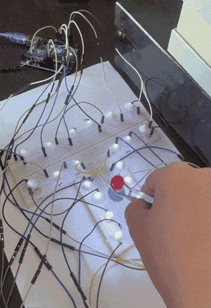
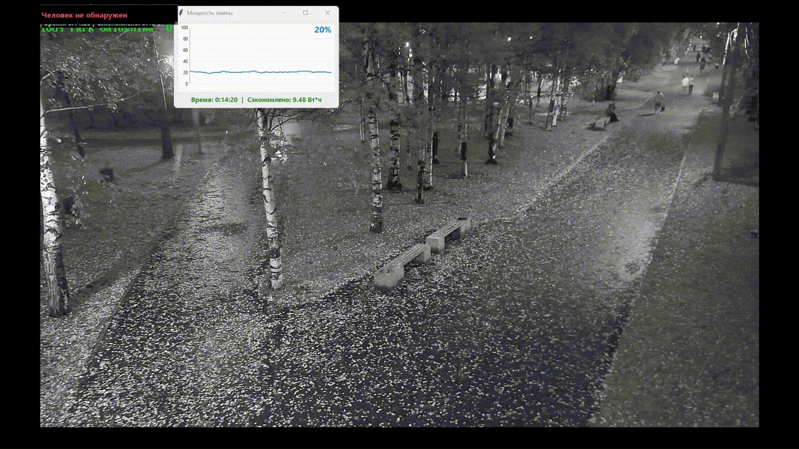

# ProxiLume (Proximity-Based Adaptive Park Lighting System)

An intelligent lighting system that dynamically adjusts streetlight brightness based on pedestrian presence and distance, designed to improve energy efficiency and safety in public spaces.

## ProxiLume in Action

## Overview

**ProxiLume** is a smart adaptive lighting system developed as a final project for the **AILT918 course at the University of Hong Kong (HKU)**.

The system is designed to dynamically adjust the brightness of park streetlights based on pedestrian presence and distance. When a person approaches a light, its brightness increases to provide sufficient illumination. As the person moves away, the brightness gradually decreases to avoid unnecessary energy consumption.

The project aims to create a more energy-efficient and responsive lighting solution for public spaces while maintaining comfortable visibility and pedestrian safety.

## Key Features

- **Pedestrian Detection:** Detects the presence of pedestrians near streetlights.
- **Distance-Based Brightness Control:** Adjusts lighting intensity according to the distance of detected pedestrians.
- **Adaptive Illumination:** Increases brightness when pedestrians approach and reduces it when they move away.
- **Energy Efficiency:** Minimizes unnecessary electricity consumption by avoiding continuous operation at full brightness.
- **Improved Public Safety:** Provides increased illumination around pedestrians in parks and other public spaces.

## System Architecture

The ProxiLume system consists of three main functional stages:

1. **Pedestrian Detection:** Sensors monitor the surrounding area to detect pedestrians and determine their proximity to the streetlights.
2. **Control and Processing:** The control unit processes sensor data and determines the appropriate brightness level based on the detected pedestrian's distance.
3. **Adaptive Lighting:** LED streetlights adjust their brightness according to the control signals, providing stronger illumination when pedestrians are nearby and reducing brightness when the area is unoccupied.

These stages work together to provide responsive lighting while minimizing unnecessary energy consumption.

## Hardware Components

The ProxiLume prototype is built using a microcontroller, a mini computer, and basic electronic components to implement the adaptive lighting system.

| **Component** | **Quantity** | **Description** |
| --- | ---: | --- |
| Mini Computer | 1 | Handles higher-level processing and system operations. |
| Arduino Uno | 1 | Controls the LED lighting and processes control signals. |
| Resistors | 12 | Limit current flowing through the LEDs. |
| LED Lights | 12 | Represent the individual streetlights in the prototype. |
| Connecting Wires | As required | Connect the electronic components and establish circuit connections. |

## Software and Control

The ProxiLume system uses a mini computer and an Arduino Uno to manage pedestrian detection and adaptive lighting control. The mini computer processes sensor information and determines the appropriate lighting intensity, while the Arduino Uno controls the brightness of the 12 LED lights.

### Source Code

The software consists of two main programs:

- **[ProxiLume.py](software/ProxiLume.py)** – Main Python program responsible for processing sensor information and managing the adaptive lighting system.

The Arduino software (`ProxiLume_Arduino.exe`) is available in the [Releases](https://github.com/Dimash-X/ProxiLume_Proximity_Based_Adaptive_Park_Lighting_System/releases) section of this repository.

## Working Principle

1. **Pedestrian Detection:** LoRa-based sensors detect the presence of pedestrians in the monitored area.
2. **Data Transmission:** The sensors transmit detection and distance information to the central system using LoRa communication.
3. **Data Processing:** The mini computer processes the received information and determines the appropriate lighting intensity.
4. **Control Signal:** The mini computer sends control commands to the Arduino Uno.
5. **Adaptive Lighting:** The Arduino Uno adjusts the brightness of the 12 LED lights according to the received commands.
6. **Continuous Monitoring:** The system continuously receives sensor updates and adjusts the lighting as pedestrians move through the area.

## Future Improvements

- Improve pedestrian detection accuracy and distance estimation.
- Optimize LoRa communication for more reliable data transmission.
- Expand the system to support a larger number of streetlights and sensors.
- Implement more advanced brightness control strategies to further improve energy efficiency.
- Explore the possibility of integrating solar-powered lighting.

## Additional Projects

Explore more robotics, mechatronics, and engineering projects on my [GitHub profile](https://github.com/Dimash-X).

## Contact

For questions, suggestions, or project improvements, feel free to contact me at [xomidad@gmail.ru](mailto:xomidad@gmail.ru).

## Disclaimer

This project is provided for educational and experimental purposes. Anyone building, modifying, or operating the system is responsible for ensuring safe assembly, electrical connections, and operation. The author is not responsible for any damage, injury, or losses resulting from the construction or use of this project.

## License

This project is licensed under the MIT License. See the [LICENSE](LICENSE) file for details.
